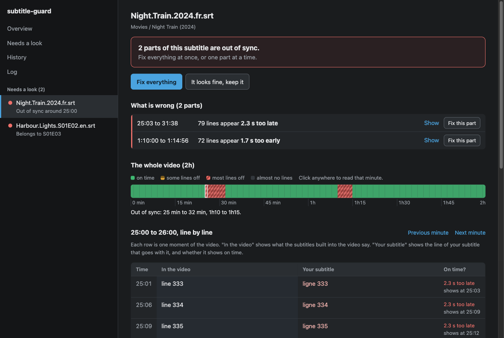
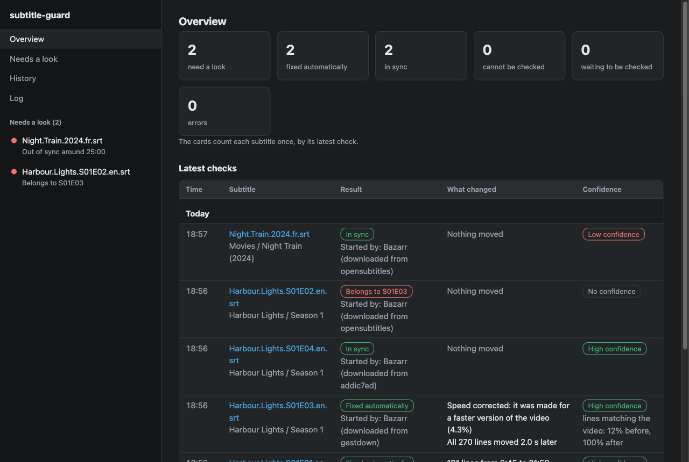
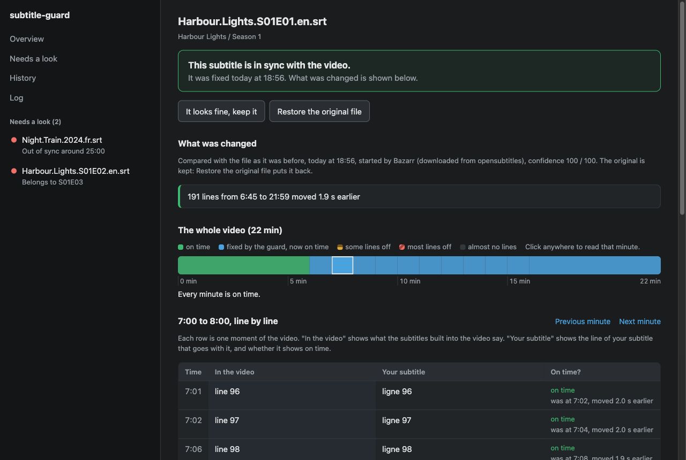
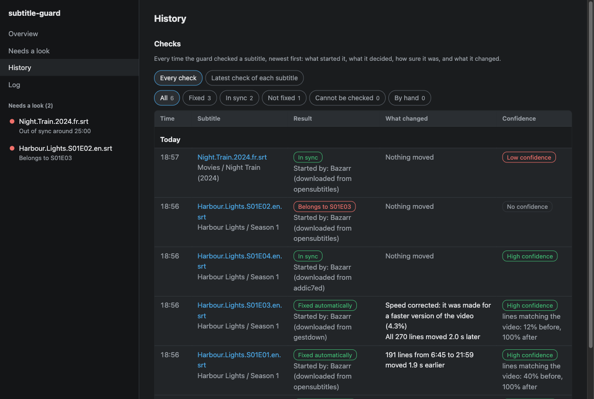

# subtitle-guard

[](https://github.com/hlecourt/subtitle-guard/actions/workflows/tests.yml)
[](https://github.com/hlecourt/subtitle-guard/actions/workflows/codeql.yml)
[](LICENSE)

Checks the timing of downloaded subtitles against a subtitle track embedded in the video (the one source of timing made for
that exact file) and repairs them when the result can be trusted.

Status: alpha. It runs as a [Bazarr](https://www.bazarr.media/) post-processing hook, or on its own over media folders, with a
job queue, parallel workers and a web UI that anyone can use to review and fix what the guard was not sure about.



## Why

Subtitles found online are often made for another release: a streaming cut instead of the Blu-ray, a 25 fps PAL master
instead of 23.976, a TV recording with ad breaks. Audio-based tools such as ffsubsync apply a single offset and framerate,
which cannot fix a different cut, and they sometimes report success on a wrong result. subtitle-guard instead:

- reads the timing of a subtitle track already embedded in the video (text or image, any language, forced and commentary
  tracks excluded) from the Matroska Cues index in well under a second, with a full read as fallback;
- realigns the downloaded subtitle piecewise with an exact dynamic programming search over offsets (0.05 s steps, +/-400 s,
  then +/-1200 s at 0.1 s steps when that fails), using line starts and ends, after picking the framerate ratio;
- accepts the result only if it clearly beats the same search against a time-mirrored reference (a null with the same density
  but no relation to the subtitle), and only if every part of the result is supported by the reference;
- writes the fix on its own only when its confidence is high (80 or more); any other fix is kept as a proposal that a person
  listens to and applies or discards, and the file stays as it is meanwhile;
- with Bazarr, asks for another subtitle first whenever a download is not in sync with high confidence (a proposal, a subtitle
  that cannot be fixed, or one that belongs to a neighbouring episode), keeps the best version tried, and only then leaves it
  for a person.

Every change to a subtitle is made by one writer at a time, after a backup, atomically, and only if the file did not change
during the check. Backups are only made when something is written; each subtitle keeps its first version, its last 5 versions
(`SUBTITLE_GUARD_KEEP_VERSIONS`) and anything from the last 30 days (`SUBTITLE_GUARD_KEEP_DAYS`). Only the timing lines change: text, styles, encoding and line endings are kept.

The mode decides whether anything is written: `report` (the default, so a first install only shows what it would do) or
`fix`. The Bazarr `hook`, `serve` and the folder watch follow it, and in `report` mode Bazarr is never asked for another
subtitle either; `check` and the scans are dry runs unless `--apply` is given.

## Install

### Docker, next to Bazarr

```
curl -O https://raw.githubusercontent.com/hlecourt/subtitle-guard/main/examples/docker-compose.yml
docker compose up -d
docker compose logs subtitle-guard | grep password
```

Open `http://<host>:8484` and log in as `admin` with the password printed in the logs on first start, or set the account
with `SUBTITLE_GUARD_UI_USER` and `SUBTITLE_GUARD_UI_PASSWORD`, or later with `docker compose exec subtitle-guard subtitle-guard
set-password`. The image (`ghcr.io/hlecourt/subtitle-guard`, amd64 and arm64) runs as uid 1000: set `user:` to the owner of your
media and of Bazarr's files. Both containers must mount the media and Bazarr's `/config` at the same paths. Then set up the hook below.

### With pip

```
pip install "subtitle-guard[audio] @ git+https://github.com/hlecourt/subtitle-guard"
```

It needs Python 3.11 or later, `ffmpeg` and `ffprobe` on the PATH, and a POSIX system (Linux, macOS): it relies on `fcntl`
locks. The `audio` extra adds ffsubsync for videos without any embedded subtitle track.

## Set up Bazarr

In Bazarr, Settings > Subtitles > Post-processing, turn on post-processing and use this command (Bazarr runs it without a
shell). It queues a check and returns at once; the workers do the work:

```
/usr/bin/env PYTHONPATH=/config/subtitle-guard/hook /lsiopy/bin/python -m subtitle_guard hook --queue "{{episode}}" "{{subtitles}}" "{{subtitles_language_code2}}" "{{provider}}" "{{subtitle_id}}" "{{episode_id}}" "{{series_id}}"
```

`/lsiopy/bin/python` is the Python of the linuxserver.io Bazarr image, which has numpy. `/config/subtitle-guard/hook` is
where `serve` copies the package at every start when `SUBTITLE_GUARD_HOOK_DIR` is set, as in the compose example, so the hook
always matches the running version. Without Docker, point `PYTHONPATH` at a clone's `src` folder instead. Without `--queue`,
the hook checks the subtitle inline before Bazarr goes on.

Turn off Bazarr's own audio sync (`use_subsync`): Bazarr runs it before the post-processing command, so it rewrites the file
without any confidence check and the guard never sees the subtitle as downloaded. The guard falls back to ffsubsync by itself
for videos without any embedded track, and marks those results as not verified.

Leave Bazarr's post-processing threshold off (`use_postprocessing_threshold`, and the movie one): when it is on, Bazarr runs the
command only for subtitles scored below it, so the best-scored downloads are never checked. Bazarr's score rates how well the
release name matches, not the timing.

To check that it works, download a subtitle from Bazarr and look at the Log page: you should see `bazarr.hook-received`, then
`job.started` and `guard.checked` for that file.

## Without Bazarr

`scan-folder` checks every video under a folder against its external subtitles (`Movie.fr.srt`, `Show.S01E02.en.hi.ass`...).
Samples and hidden folders are skipped, and episode neighbours for the wrong-episode check come from `SxxEyy` or `NxNN` file
names. `watch` queues every new or changed subtitle under one or more folders; `serve` does the same for the folders in
`SUBTITLE_GUARD_LIBRARY`. Without Bazarr a subtitle that is not in sync with high confidence stays as it is and shows up for
review, with its proposal when there is one; nothing is downloaded.

## Web UI

`subtitle-guard ui`, or `serve`, which also runs the workers, opens a web UI on port 8484. It is written for anyone, in plain
words, and fits phones, tablets and large screens.



- **Overview**: how many subtitles need a look, were fixed automatically, are in sync or cannot be checked (each subtitle
  counted once, by its latest check), tasks in progress or failed, and the latest checks.
- **Needs a look**: the subtitles the guard was not sure about, one sentence each ("Out of sync around 25:00", "Belongs to
  S01E03"), with the obvious fix as one button. It stays in a sidebar on every page.
- **One page per subtitle**: what is going on in one sentence, each wrong part ("25:03 to 31:38: 79 lines appear 2.3 s too
  late") with **Fix this part**, and **Fix everything** (applies the proposal), **It looks fine, keep it**, **Restore the original
  file**, **Try another subtitle** (Bazarr) and **Delete this subtitle** (wrong episode) when they apply. A timeline shows every minute (patterns, not
  only colours, and a text summary), and a line-by-line view puts each moment of the video next to the line of your subtitle
  that goes with it. Lines can be realigned by hand from the keyboard. For a fixed subtitle, the page shows what was changed
  and where each line was.
- **Listen and edit**: an editor to check a subtitle by ear, most useful when the video has no subtitles of its own. The lines
  are listed on the left, a picture of the video (updated when paused) shows the current line on top of it, and a waveform of
  the sound shows your lines as blocks, with the video's own subtitles in a grey lane under them when there are some. Play,
  move every line or a selection earlier or later (buttons, a number, or by dragging the blocks), listen again, then apply:
  the file is backed up first and the change is refused if the file changed meanwhile. The sound is cut into one-minute
  clips by ffmpeg on demand, one at a time, and never stored.
- **History**: every check, newest first, with what started it, the result, the confidence and what changed (speed corrected,
  which lines moved, how far and which way), and the tasks waiting, running or failed with **Run again**.
- **Log**: the technical log, one line per event; each line opens on its full metadata as JSON with a Copy button. The raw log
  downloads from `/log.jsonl`.



Keyboard: `j` and `k` move between subtitles, Left and Right between minutes. Pages refresh themselves when something changed,
unless you are reading an open line or typing. JSON is at `/api/status`, `/api/jobs`, `/api/review` and `/api/log`; `/health` says
the server is up and `/ready` checks the database and every worker.



## Security

- On loopback the UI needs no login. Anywhere else it needs a user name and password: `SUBTITLE_GUARD_UI_USER` and
  `SUBTITLE_GUARD_UI_PASSWORD`, or an account set with `subtitle-guard set-password` (stored as a scrypt hash with mode 600), or on
  first start without either, a password for `admin` generated and printed once. A broken account file stops the UI instead of
  opening it. Five wrong attempts lock a client out for 10 minutes. Logging in opens a session that expires on the server after
  30 days (HttpOnly, SameSite=Strict, Secure behind an HTTPS proxy that sets `X-Forwarded-Proto`); logging out ends it.
- Every action is a POST with a CSRF token, from the same origin; without a token only loopback host names are accepted. Pages
  send a strict Content-Security-Policy and refuse to be framed. Requests are size- and time-limited.
- The UI only acts on subtitles the guard already checked, never through a symlink, and only under `SUBTITLE_GUARD_ROOTS` (or the
  watched folders) when set.
- Report vulnerabilities privately: see [SECURITY.md](SECURITY.md).

## Running as a service

`subtitle-guard serve` runs a supervisor, `SUBTITLE_GUARD_WORKERS` worker processes (2 by default), the web UI and the folder
watch. Only one supervisor can run on a state directory. A worker that dies is restarted and its job requeued; a job that killed
its worker three times is marked failed. SIGTERM stops every role and the tools they started. Alignment runs in parallel; full
file reads and ffsubsync take turns through a lock so workers do not fight over a spinning disk. A Bazarr download that is not
trusted becomes a `blacklist` job, then a `retry-check` 15 minutes later that keeps the best version tried if Bazarr found
nothing else.

```
subtitle-guard status                     # jobs by status and confidence band
subtitle-guard jobs [failed]              # latest jobs
subtitle-guard job 42                     # one job in full, with its error if any
subtitle-guard retry 42                   # run a finished or failed job again
subtitle-guard scan-all --apply --queue   # check the whole library through the workers
subtitle-guard needs-human                # subtitles whose last check needs a person
subtitle-guard log 100 --problems         # the last warnings and errors
```

### Log

Everything goes to one log, `subtitle-guard.log` in the state directory (rotated at 10 MB under a lock), and to stdout for the
service, so `docker logs` shows it. Each line is one JSON event: `time`, `level` (`debug`, `info`, `warning`, `error`), `source`
(the process: `serve`, `supervisor`, `worker-1`, `web`, `watch`, `hook`, `cli`), `pid`, `event`, a short technical `message`, then
the metadata; events written while a job runs also carry its `job` id. Events are named `component.past-tense`, for example
`service.started` and `health.checked` at start, `bazarr.hook-received`, `bazarr.api-call`, `job.started`, `guard.checked` (with
the decision, confidence, alignment figures and changes), `guard.rewritten`, `job.succeeded`, `job.failed` (with the trace),
`review.shifted` for actions taken in the UI, and `supervisor.stopping`.

### Settings

Every setting below except the folders, the state and the backups can also be changed in the UI; a variable that is set always
wins and shows as locked there.

| Variable | Default |
|---|---|
| `SUBTITLE_GUARD_STATE` | `/config/subtitle-guard` (`/config` in the image): queue, history, log, caches, UI account |
| `SUBTITLE_GUARD_BACKUPS` | `/data/backup/subtitle-guard` (`/backup` in the image) |
| `SUBTITLE_GUARD_AUDIO_AUTOMATIC` | unset; `1` lets a high-confidence audio sync be written without a person, once `calibrate-audio` found no false positive |
| `SUBTITLE_GUARD_KEEP_VERSIONS` / `SUBTITLE_GUARD_KEEP_DAYS` | `5` / `30`: backups kept per subtitle besides its first version |
| `SUBTITLE_GUARD_MODE` | `report`; `fix` lets the guard write high-confidence fixes on its own |
| `SUBTITLE_GUARD_WORKERS` | `2` |
| `SUBTITLE_GUARD_REPLACEMENTS` | `3`: other subtitles asked from Bazarr before keeping the best version |
| `SUBTITLE_GUARD_WEBHOOK_URL` / `SUBTITLE_GUARD_WEBHOOK_MINUTES` | unset / `15`: a digest of what reached Review, at most once per interval |
| `SUBTITLE_GUARD_URL_BASE` | unset; for example `/subtitle-guard` behind a reverse proxy, applied on restart |
| `SUBTITLE_GUARD_AUTH` | `forms`; `local` skips the login from private addresses, `external` trusts a reverse proxy that authenticates |
| `SUBTITLE_GUARD_API_PORT` | `8485`, the new API while it is built beside the current UI |
| `SUBTITLE_GUARD_AUDIO_CACHE_MB` | `2048`: light audio copies the editor plays, least recently played removed first |
| `SUBTITLE_GUARD_QUEUE` | unset; `1` makes `hook` queue its job, like `--queue` |
| `SUBTITLE_GUARD_HOOK_DIR` | unset; a folder Bazarr also sees, where `serve` copies the package for the hook |
| `SUBTITLE_GUARD_LIBRARY` | unset; folders to watch in `serve`, separated by `:` |
| `SUBTITLE_GUARD_WATCH_SECONDS` | `600` |
| `SUBTITLE_GUARD_ROOTS` | the watched folders; the UI only acts on subtitles under these folders |
| `SUBTITLE_GUARD_UI_HOST` / `SUBTITLE_GUARD_UI_PORT` | `127.0.0.1` / `8484` (`0.0.0.0` in the image) |
| `SUBTITLE_GUARD_UI_USER` / `SUBTITLE_GUARD_UI_PASSWORD` | `admin` / unset; beyond loopback a password is required, generated once when unset |
| `SUBTITLE_GUARD_FFSUBSYNC_PATH` | `/app/bazarr/bin/libs`, where the linuxserver.io Bazarr image keeps ffsubsync; empty in the image, which installs it |
| `BAZARR_URL` | `http://localhost:6767` |
| `BAZARR_API_KEY` | read from `BAZARR_CONFIG` |
| `BAZARR_CONFIG` | `/config/config/config.yaml` |

## Decisions

| Decision | Meaning |
|---|---|
| `kept` | already in sync, nothing written |
| `fixed` | realigned and verified with high confidence, written, original backed up (in a dry run: would be written) |
| `proposed` | a fix was found but its confidence is not high, or it comes from the audio while automatic audio writes are off; nothing written, it waits for a person |
| `approved` | a proposal applied by a person, original backed up |
| `rejected` | could not be realigned with confidence, or the end times are wrong; with Bazarr, another subtitle is requested |
| `wrong-episode` | the subtitle matches a neighbouring episode; with Bazarr, another subtitle is requested, it is never moved |
| `deleted` | deleted by a person, a copy is kept in the backups |
| `unverified` | nothing to compare with, too few lines, the video could not be read, or the file changed during the check |

An audio sync has no reference track to compare with, so its confidence comes from the sound itself: the synced subtitle is cut
into up to eight parts of at least twenty lines, each part is searched on its own against the speech that ffsubsync's voice
detector finds, and the confidence is the share of parts that land within 0.3 s of where the sync put them (below four parts it
stays at 30). `subtitle-guard calibrate-audio PATH [N]` measures how far that can be trusted on your own library, without writing
anything: for videos whose reference track gives the truth, it shifts a copy of the subtitle by a known amount, syncs it to the
audio as if there were no track, and counts the confident results that are wrong.

Each decision carries a confidence from 0 to 100 and a band: `high` (80 and up), `medium` (60 to 79), `low` (below 60), `none`
(nothing accepted). It takes the weakest of three measures (the margin over noise or over the null alignment, the margin of the
worst 2-minute window, and for realigned files the share of lines in supported segments), then removes 10 points per weak minute.

## Accuracy

`benchmarks/torture.py` misaligns known-good tracks in 42 ways and measures every line against its true time, and exits non-zero
when a case fails. On a private corpus of 12 tracks of 420 to 720 lines (French, Japanese and German, one dialogue-heavy series),
502 of 504 runs ended as expected, with 97 to 100% of lines within one second when fixed: different cuts, ad breaks adding up to
600 s, offsets up to 600 s, framerate and speed errors up to 5%, sloppy timing, merged or split lines, and dense stretches.
Wrong-episode subtitles, random timings and offsets beyond +/-1200 s were rejected. These figures cannot be reproduced without
that corpus. To measure on a public one, built from the Blender open movie Tears of Steel and its six translations:

```
python benchmarks/tears_of_steel.py /tmp/tos
python benchmarks/torture.py /tmp/tos/work /tmp/tos/corpus.json
```

## Limits

- Cumulative offsets beyond +/-1200 s are rejected, not fixed; between +/-400 s and +/-1200 s a rejection costs a second, wider
  search (about 7 s instead of 2.5 s on a 4-core home server).
- Lines of a scene that exists in the subtitle but not in the video are placed as well as possible, not removed.
- Without any embedded subtitle track, timing cannot be verified; the ffsubsync fallback cannot fix a different cut.
- Subtitles over 20 MB or 20,000 lines are not checked.

## Troubleshooting

- **Nothing happens when Bazarr downloads a subtitle**: the Log page shows no `bazarr.hook-received`. Check that post-processing
  is on, that the command path and `PYTHONPATH` are right inside the Bazarr container, and Bazarr's own log for the command output.
- **`health degraded failing=ffsubsync`** at start: ffsubsync is not importable; install the `audio` extra or set
  `SUBTITLE_GUARD_FFSUBSYNC_PATH`. Only videos without an embedded track need it.
- **"Cannot be checked: could not read the video"**: ffprobe failed on the file; the reason is in the `guard.checked` event.
- **Files owned by root or not writable**: run the container with `user:` set to the owner of the media.
- **`/ready` answers 503**: a worker stopped sending heartbeats; the Log page shows `supervisor.role-restarted` or `job.failed`.

## Development

```
python -m venv .venv && .venv/bin/pip install -e ".[dev]"
.venv/bin/python -m pytest -q --cov=subtitle_guard
.venv/bin/ruff check src tests benchmarks
```

See [CONTRIBUTING.md](CONTRIBUTING.md) for the test policy and the release process, and [CHANGELOG.md](CHANGELOG.md) for what
changed. This project follows the [Contributor Covenant](CODE_OF_CONDUCT.md).

## Licence

GPL-3.0-or-later. See [LICENSE](LICENSE).
