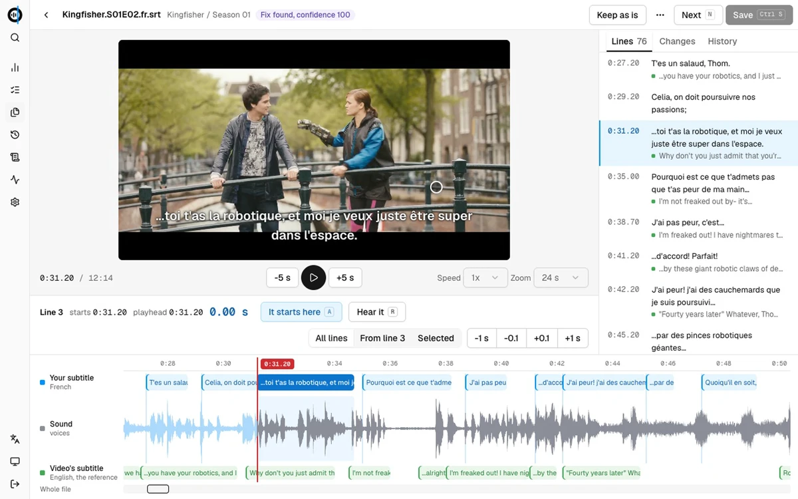
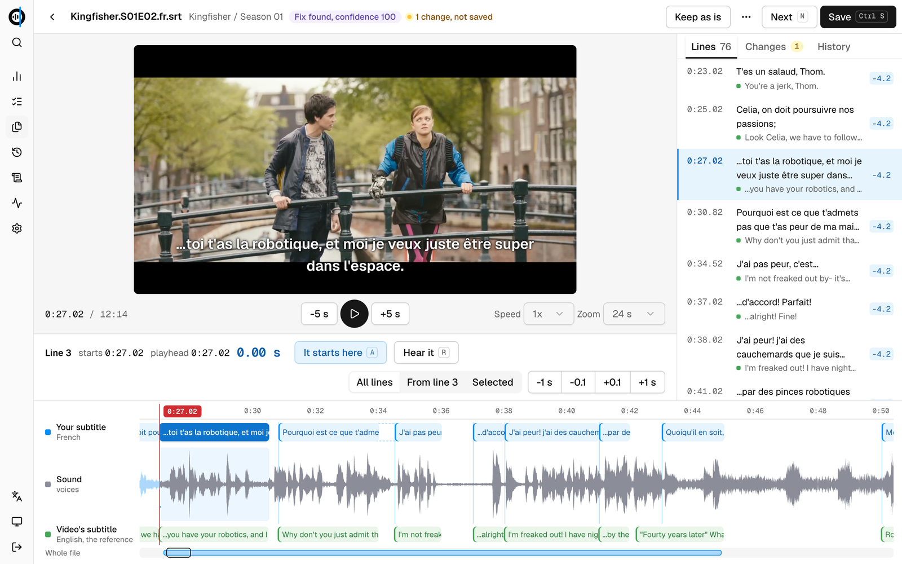
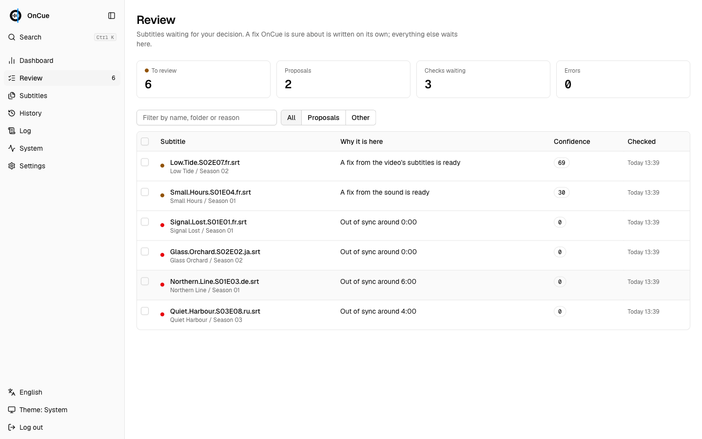
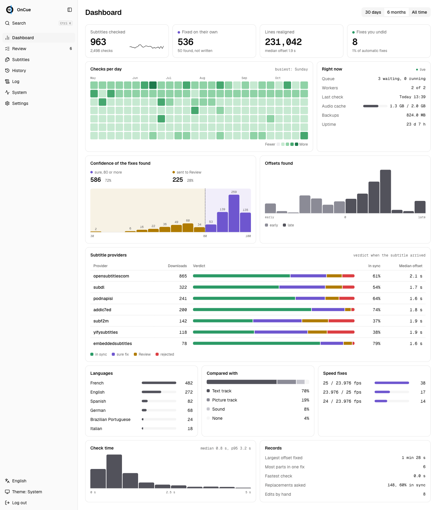

#  OnCue

[](https://github.com/hlecourt/oncue/actions/workflows/tests.yml)
[](https://github.com/hlecourt/oncue/actions/workflows/codeql.yml)
[](LICENSE)

Out-of-sync subtitles, fixed for you. OnCue checks every external subtitle in your media library against the
subtitle track embedded in the video, fixes the timing on its own when it is sure, and lets you fix the rest by ear in a web
editor. It works on the folders of a Jellyfin, Plex or Emby library, and can also plug into Bazarr.

Status: alpha.



## Why

Subtitles found online are often made for another release: a streaming cut instead of the Blu-ray, a 25 fps master instead of
23.976, a TV recording with ad breaks. Audio-based tools such as ffsubsync mostly apply one offset and one frame rate, and
automatic syncs rarely tell you when they got it wrong. OnCue instead:

- compares your subtitle with a track already embedded in the video (text or picture, any language), which is the one
  source of timing made for that exact file;
- realigns it part by part, so ad breaks, cuts and frame rate errors are fixed, not just a global offset;
- only trusts a fix that clearly beats the same search against a meaningless reference, and scores it from 0 to 100;
- writes on its own only at 80 or more; anything else waits for you in a review queue;
- changes only the timings, after a backup, and never while the file is being changed by something else.

How it decides, step by step: [docs/how-it-works.md](docs/how-it-works.md).

## Quick start

```
curl -O https://raw.githubusercontent.com/hlecourt/oncue/main/examples/docker-compose.yml
docker compose up -d
docker compose logs oncue | grep password
```

Edit the media paths in the file first: `ONCUE_LIBRARY` lists the folders to watch, `ONCUE_ROOTS` the only
folders whose subtitles may be changed, and `user:` must own your media. Then open `http://<host>:8484` and log in as `admin`
with the password printed in the logs.

OnCue checks every external subtitle it finds (`Movie.fr.srt`, `Show.S01E02.en.hi.ass`) and every new or changed one
after that. It starts in `report` mode: it shows what it would do and writes nothing until you switch to `fix` in Settings.

Without Docker: `pip install "oncue[web,audio]"` from a release wheel, with Python 3.11+, `ffmpeg` and `ffprobe`
on a Linux or macOS machine; see [docs/configuration.md](docs/configuration.md).

## With Bazarr (optional)

With [Bazarr](https://www.bazarr.media/), OnCue checks each subtitle as soon as it is downloaded, and when a download is
not in sync with confidence it asks Bazarr for another one before bothering you, keeping the best version tried. Use
[examples/docker-compose.bazarr.yml](examples/docker-compose.bazarr.yml), then in Bazarr, Settings > Subtitles >
Post-processing, turn post-processing on with this command:

```
/usr/bin/env PYTHONPATH=/config/oncue/hook /lsiopy/bin/python -m oncue hook --queue "{{episode}}" "{{subtitles}}" "{{subtitles_language_code2}}" "{{provider}}" "{{subtitle_id}}" "{{episode_id}}" "{{series_id}}"
```

And turn off two Bazarr options, or OnCue never sees the downloads as they arrive:

- **Subtitle synchronization** (`use_subsync`): it rewrites each file before OnCue sees it, without any confidence check.
- **Post-processing threshold** (series and movies): it skips the best-scored downloads, and that score rates release names,
  not timing.

To check it works, download a subtitle from Bazarr: the Log page shows `bazarr.hook-received`, then `guard.checked`.

## The web UI

In plain words, in English, French or Simplified Chinese, light or dark, on a phone or a large screen.

- **Review**: what waits for a decision, one sentence each, with Keep and Check again for several at once.
- **Editor**: the video, your lines, and a timeline with your subtitle, the sound and the video's own subtitle. Play, press
  **It starts here** where the voice starts, or nudge by 0.1 s or 1 s, on every line, from a line on, or on a selection;
  changes add up and one Save writes them, after a backup. The keyboard does it all (press `?`).
- **Dashboard**: what OnCue did over a period: checks, fixes, offsets, languages, and with Bazarr, subtitle providers
  ranked by how often their downloads arrive in sync.
- **Subtitles**, **History**, **Log**, **System** and **Settings** for everything else.







The video in these images is [Tears of Steel](https://mango.blender.org), (c) Blender Foundation, licensed under
[CC BY 3.0](https://creativecommons.org/licenses/by/3.0/).

Scripts use the JSON API under `/api` (described at `/api/openapi.json`) with an `X-Api-Key` header.

## Safety

- `report` mode by default: nothing is written until you choose `fix`.
- Nothing is written outside `ONCUE_ROOTS` (the compose examples set it), and never through a symbolic link.
- Every write is atomic, after a backup, and refused if the file changed since it was checked; saved versions can be restored.
- A login is required beyond the machine itself. Details: [docs/security.md](docs/security.md); to report a vulnerability,
  [SECURITY.md](SECURITY.md).

## Settings

Most settings can be changed in the UI; an environment variable always wins. The ones you are most likely to need:

| Variable | Default |
|---|---|
| `ONCUE_MODE` | `report`; `fix` writes sure fixes on its own |
| `ONCUE_LIBRARY` | unset: the media folders to watch |
| `ONCUE_ROOTS` | unset: the folders OnCue may change; nothing is written when unset |
| `ONCUE_WORKERS` | `2` |
| `ONCUE_UI_USER` / `ONCUE_UI_PASSWORD` | `admin` / generated on first start |
| `BAZARR_URL` / `BAZARR_API_KEY` | `http://localhost:6767` / read from Bazarr's config |

All of them, the CLI and the log format: [docs/configuration.md](docs/configuration.md).

## Accuracy

`benchmarks/torture.py` misaligns known-good tracks in 42 ways and measures every line against its true time. On a private
corpus of 12 tracks (French, Japanese and German), 502 of 504 runs ended as expected, with 97 to 100% of lines within one
second when fixed; wrong-episode subtitles and random timings were rejected. A public corpus can be built from the Blender
open movie Tears of Steel:

```
python benchmarks/tears_of_steel.py /tmp/tos
python benchmarks/torture.py /tmp/tos/work /tmp/tos/corpus.json
```

## Limits

- Cumulative offsets beyond +/-1200 s are rejected, not fixed.
- Lines of a scene missing from the video are placed as well as possible, not removed.
- Without any embedded subtitle track, timing cannot be verified, and the audio fallback cannot fix a different cut.
- Subtitles over 20 MB or 8,000 lines are not checked.

## Troubleshooting

- **A subtitle is never checked**: it must sit next to its video with the video's name (`Movie.mkv`, `Movie.fr.srt`) under a
  folder of `ONCUE_LIBRARY`. With Bazarr, check that post-processing is on and that the command's paths exist inside
  the Bazarr container.
- **"Cannot be checked: could not read the video"**: the reason is in the `guard.checked` event on the Log page.
- **Files owned by root or not writable**: set `user:` in the compose file to the owner of the media.
- **`/ready` answers 503**: a worker stopped; the Log page shows `supervisor.role-restarted` or `job.failed`.

## Development

```
python -m venv .venv && .venv/bin/pip install -e ".[dev]"
.venv/bin/python -m pytest -q
```

See [CONTRIBUTING.md](CONTRIBUTING.md) for the front, the tests and releases, and [CHANGELOG.md](CHANGELOG.md) for what
changed. This project follows the [Contributor Covenant](CODE_OF_CONDUCT.md).

## Licence

GPL-3.0-or-later. See [LICENSE](LICENSE).
